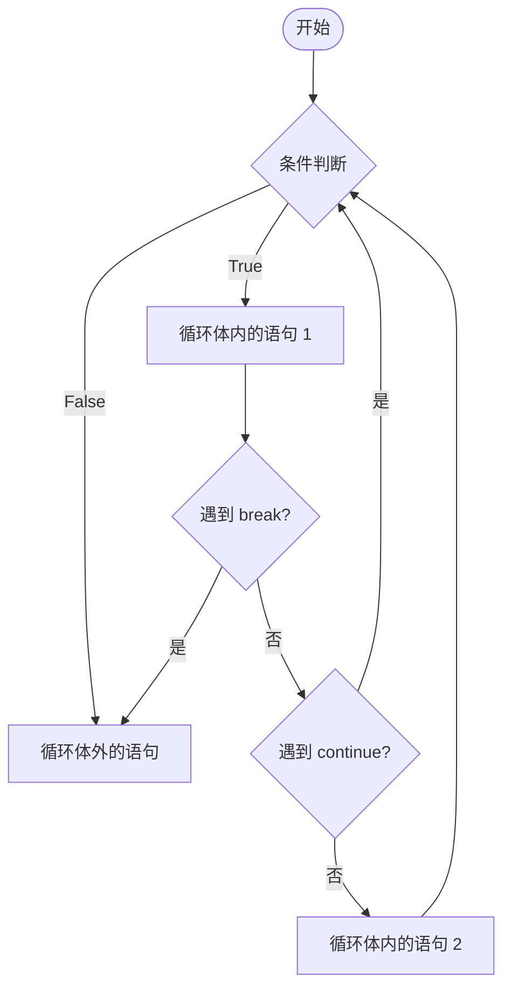

# 第17集 >>> 了不起的分支和循环(Ⅳ)

> 课程：小甲鱼《零基础入门学习python》 ｜ 日期：2026-11-18 ｜ 进度：17/38

## 🎯 本节目标
- [x] 还是·了解continue语句和Break语句
- [x] 掌握else语句的用法
- [x] 了解while·else语句设计的作用 

## 📌 核心知识点
### 一. continue与Break语句区别
- **continue语句** 也会跳出循环体，但只是跳出本轮循环，还会回到循环体的条件判断位置 ➡ 继续下一轮循环(如果条件还成立的话).
- **Break语句**则是直接跳出循环体.

>***但不论是Break语句还是continue语句，他们只能作用于一层循环体.***
####  代码实录(验证 ⬆)
```
"""检验beak和continue语句只能跳出一层循环体"""
day = 1
hour = 1
while day <= 7:
    while hour <= 8:
        print("我今天一定要坚持学习8个小时!")
        hour += 1
        if hour > 1:
            break
        day += 1
        input("按回车键退出")
```

> 如果break语句同时跳出2个循环体，那么 **"print(……)"** 只打印一次;如果只跳出内层循环则会来到 **"day + = 1"** 这个位置，就会打印7次.


### 二. else语句设计的作用
    引言: 在分支结构中很重要在循环结构中也有他的事.
- 当循环的条件不再为真的时候，便会执行else语句的内容.
- **定义:** 当循环的条件不再为真的时候，便会执行else语句的内容.
- **while,else 设计的作用** **:**
可以非常容易的检测到循环的退出情况.⬇
#####  代码实录
```
"""每周打卡小程序"""
day = 1
while day <= 7:
    answer = input("今天有好好学习吗?")
    if answer != "有":
        break
    day += 1
else:
    print("非常棒，你已经坚持了7天连续学习!")
   
```

>如果用**Break语句跳出循环**(是中途跳出来的) ➡ 这时整个循环体的条件依旧为真，所以-else语句的内容不会被执行.

>也就是说，如果这个循环完整执行7遍的话，才会执行else语句的内容，但只要有一天输入的不是"有" *就会跳出循环* [^1]
---

## 💻 代码实录
```
"""九九乘法表"""
i = 1
while i <= 9:
    j = 1
    while j <= i:
        print(j, "*", i, "=", j * i, end=" ")
        j += 1
    print()
    i += 1
    input("按回车键退出")
```
>循环的嵌套: 该代码中"print(……)"是用于换行的.


## 💡今日心得
今天只是把昨天的内容整理了，没有学习新内容，我明天打算把这两天学的看一遍，(有点记忆不是很深刻)，再自己尝试理解，并自己再**敲几遍代码**，顺便再自己**改良一下代码**.

[^1]: 即不会执行else的内容.